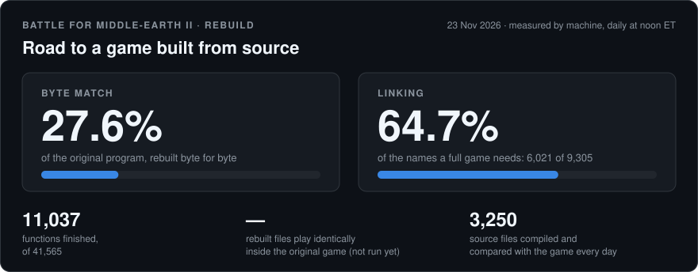
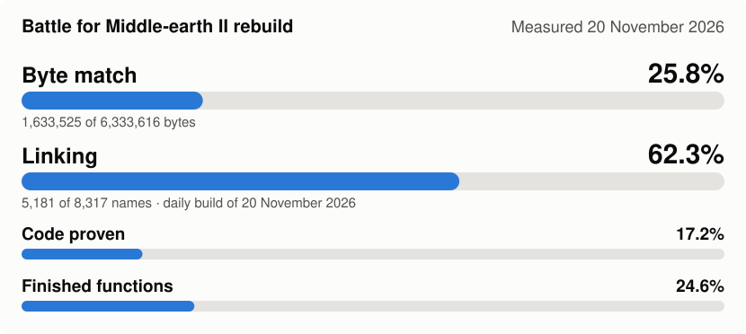
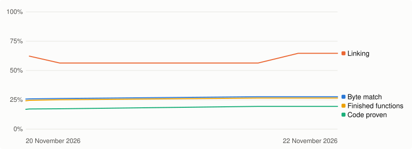

# Battle for Middle-earth II rebuild: progress

How much of the original game (version 1.06) has been rebuilt as source code that compiles back to the same machine code. Measured automatically after every change; nobody edits this page.

Measured **22 November 2026**. The code figures describe commit [`7d3b757bad14`](https://github.com/Open-BFME/BFME2-Rebuild/commit/7d3b757bad14352236dd725a3a1ce092f4bc03bd) (22 November 2026, 20:17 UTC); the build checks run every day.

## The figures

**Byte match**: `██████░░░░░░░░░░░░░░` 27.6% (1,749,396 of 6,333,616 bytes)  
How much of the original game's code, by size, our source code compiles back to byte for byte.

**Linking**: `█████████████░░░░░░░` 64.7% (6,021 of 9,306 names)  
How many of the names the game needs to be assembled into one program our source already provides.
Measured by the daily build of commit [`275e5bc86e6c`](https://github.com/Open-BFME/BFME2-Rebuild/commit/275e5bc86e6c35cbf28c1c173eafe8dc772c5fdc) (22 November 2026), which can be newer or older than the commit the other figures describe.

**Code proven**: `████░░░░░░░░░░░░░░░░` 19.4% (1,228,341 of 6,333,616 bytes)  
How much of the code, by size, is byte-matched and also confirmed at every place it refers to other code or data, so the match cannot be a coincidence.

**Finished functions**: `█████░░░░░░░░░░░░░░░` 26.5% (11,029 of 41,565 functions)  
Functions that are proven, sit in a properly named source file, and belong to a class declared in a final header. Counted in functions, not bytes: small functions are often finished first, so this figure can be ahead of the byte figures.

## Does the rebuilt game run?

Nightly build of commit [`275e5bc86e6c`](https://github.com/Open-BFME/BFME2-Rebuild/commit/275e5bc86e6c35cbf28c1c173eafe8dc772c5fdc) (22 November 2026): Compiles; the game run is not live yet (3,250 of 3,250 source files compile, 525 of them match the original completely).

- Starts: not run yet
- Reaches the main menu: not run yet
- Plays a skirmish: not run yet
- Equals the original game: not run yet
- Saves and loads: not run yet

## By part of the game

Byte match, by size, in each part of the source tree, largest part first.

| Part | Byte match | Bar |
| --- | ---: | --- |
| Game engine: GameLogic | 26.3% (399,763 of 1,520,680 bytes) | `█████░░░░░░░░░░░░░░░` |
| Game libraries | 52.3% (571,172 of 1,092,443 bytes) | `██████████░░░░░░░░░░` |
| Game engine: GameClient | 20.2% (171,833 of 850,669 bytes) | `████░░░░░░░░░░░░░░░░` |
| Platform layer: W3DDevice | 8.7% (46,198 of 531,429 bytes) | `██░░░░░░░░░░░░░░░░░░` |
| Game engine: Common | 35.2% (108,556 of 308,675 bytes) | `███████░░░░░░░░░░░░░` |
| Game engine: GameNetwork | 51.6% (112,226 of 217,464 bytes) | `██████████░░░░░░░░░░` |
| GameSpy SDK (online library) | 98.4% (105,280 of 106,969 bytes) | `████████████████████` |
| Platform layer: MilesAudioDevice | 0.3% (189 of 64,798 bytes) | `░░░░░░░░░░░░░░░░░░░░` |
| Lua 4.0.1 (scripting library) | 96.7% (61,462 of 63,532 bytes) | `███████████████████░` |
| FESL (EA online library) | 0.0% (0 of 42,125 bytes) | `░░░░░░░░░░░░░░░░░░░░` |
| STLport 4.6 (C++ library) | 88.2% (28,615 of 32,452 bytes) | `██████████████████░░` |
| nbench (benchmark library) | 0.0% (0 of 26,290 bytes) | `░░░░░░░░░░░░░░░░░░░░` |
| zlib 1.1.4 (compression library) | 100.0% (23,719 of 23,719 bytes) | `████████████████████` |
| ppmalloc 1.26.11 (memory allocator) | 0.0% (0 of 14,445 bytes) | `░░░░░░░░░░░░░░░░░░░░` |
| LZHL 1.0 (compression library) | 99.7% (7,125 of 7,150 bytes) | `████████████████████` |
| Platform layer: Win32Device | 57.0% (1,564 of 2,742 bytes) | `███████████░░░░░░░░░` |
| Tools | 100.0% (744 of 744 bytes) | `████████████████████` |
| Not yet placed in a named file | 8.4% (110,950 of 1,322,757 bytes) | `██░░░░░░░░░░░░░░░░░░` |
| Not yet assigned to any file | 0.0% (0 of 104,533 bytes) | `░░░░░░░░░░░░░░░░░░░░` |

Provisional class declarations still in use (files under `include/Draft/` that some source file includes): 12. Each should become a final header.

## Over time

| Commit | Date | Byte match | Linking | Proven | Finished |
| --- | --- | ---: | ---: | ---: | ---: |
| [`7d3b757bad14`](https://github.com/Open-BFME/BFME2-Rebuild/commit/7d3b757bad14352236dd725a3a1ce092f4bc03bd) | 22 November 2026, 20:17 UTC | 27.62% | 64.70% (build `275e5bc`) | 19.39% | 26.53% |
| [`cf353ffcc35d`](https://github.com/Open-BFME/BFME2-Rebuild/commit/cf353ffcc35deaeff04c647505b0c8b974ca7084) | 22 November 2026, 19:46 UTC | 27.62% | 64.70% (build `275e5bc`) | 19.39% | 26.53% |
| [`531d47ed71b5`](https://github.com/Open-BFME/BFME2-Rebuild/commit/531d47ed71b50e3f52808139d4f3f25a7dbb993b) | 22 November 2026, 19:21 UTC | 27.62% | 64.70% (build `275e5bc`) | 19.39% | 26.53% |
| [`0e08e2d5b542`](https://github.com/Open-BFME/BFME2-Rebuild/commit/0e08e2d5b54243e64a8d29601880166efc6b322e) | 22 November 2026, 18:10 UTC | 27.62% | 64.70% (build `275e5bc`) | 19.39% | 26.53% |
| [`986fc9668bdb`](https://github.com/Open-BFME/BFME2-Rebuild/commit/986fc9668bdb6f4aaf2369f7e86d35eaff153f4d) | 22 November 2026, 15:53 UTC | 27.62% | 64.70% (build `275e5bc`) | 19.39% | 26.53% |
| [`37882787b296`](https://github.com/Open-BFME/BFME2-Rebuild/commit/37882787b2967c189f39983238d336b3a9def9f0) | 22 November 2026, 15:50 UTC | 27.62% | 64.70% (build `275e5bc`) | 19.39% | 26.53% |
| [`275e5bc86e6c`](https://github.com/Open-BFME/BFME2-Rebuild/commit/275e5bc86e6c35cbf28c1c173eafe8dc772c5fdc) | 22 November 2026, 14:00 UTC | 27.61% | 64.70% | 19.39% | 26.52% |
| [`439e43d7c563`](https://github.com/Open-BFME/BFME2-Rebuild/commit/439e43d7c56323576005221fe6ffd4c0ca71ca2c) | 22 November 2026, 07:36 UTC | 27.61% | 56.40% (build `9fa818c`) | 19.39% | 26.52% |
| [`a8ba9aee59d9`](https://github.com/Open-BFME/BFME2-Rebuild/commit/a8ba9aee59d9634cf44fba99f4652f4e5b596314) | 20 November 2026, 23:55 UTC | 26.15% | 56.40% (build `9fa818c`) | 17.39% | 25.07% |
| [`69da5d735238`](https://github.com/Open-BFME/BFME2-Rebuild/commit/69da5d7352386882778ba9c6ba4a5934ffdd3be5) | 20 November 2026, 19:03 UTC | 25.79% | 62.29% (build `5f2f839`) | 17.19% | 24.59% |
| [`64fce00c1ee6`](https://github.com/Open-BFME/BFME2-Rebuild/commit/64fce00c1ee661f0ee508ad724887717cd302ecb) | 20 November 2026, 18:29 UTC | 25.69% | — | 16.91% | 24.19% |

How each figure is computed, with its exact formula: [ci/progress/README.md](https://github.com/Open-BFME/BFME2-Rebuild/blob/main/ci/progress/README.md).
